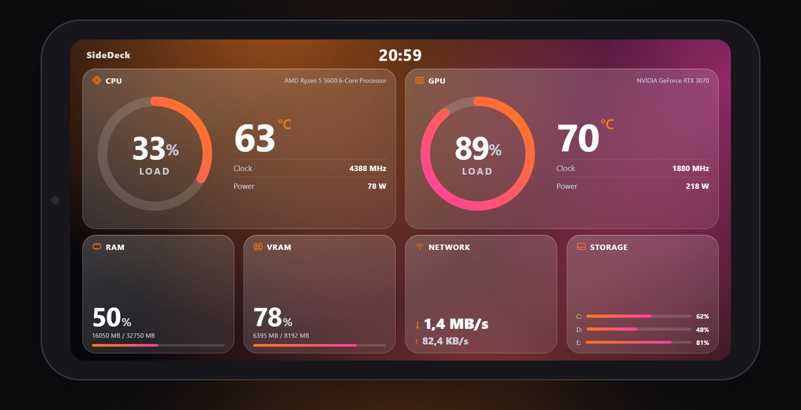
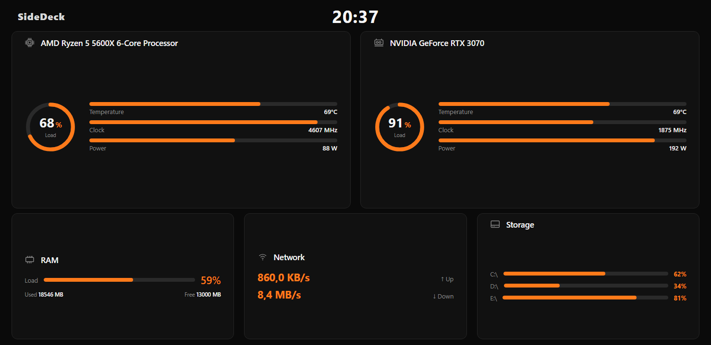
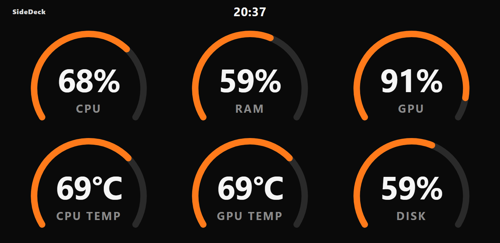
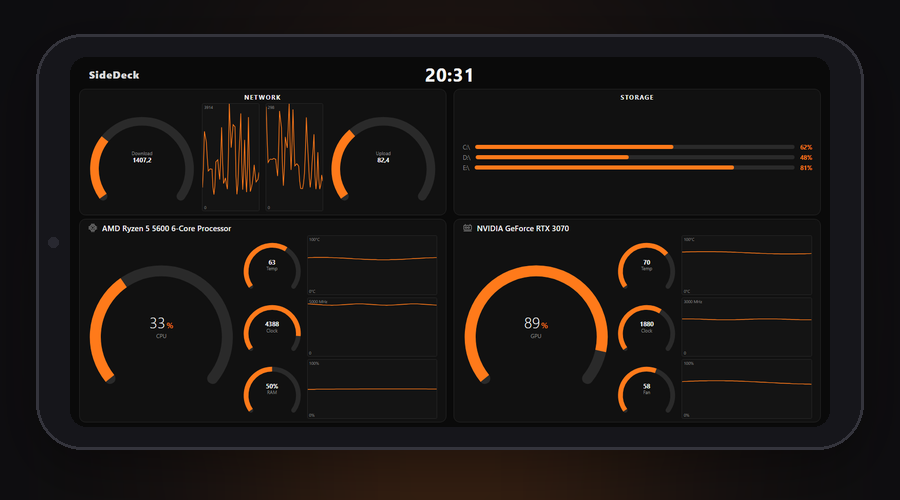
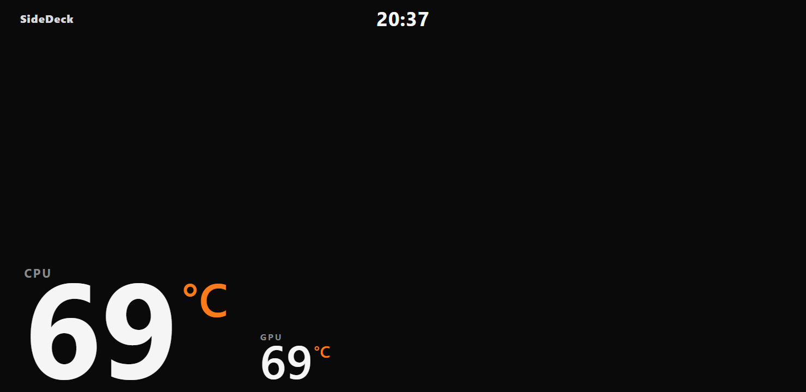
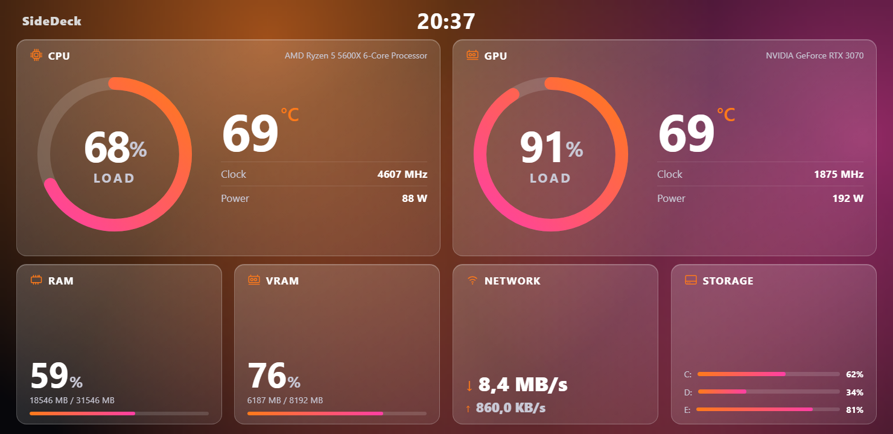
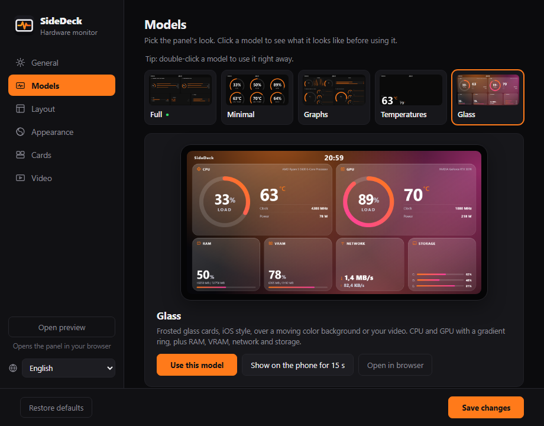
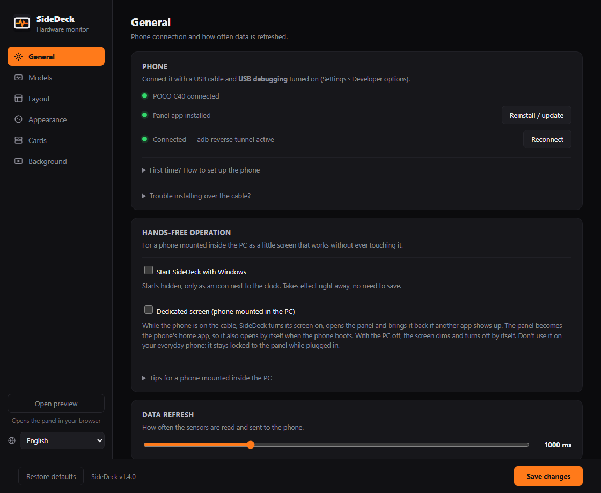
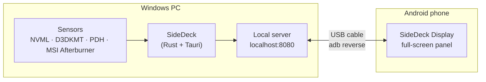

<p align="center">
  
</p>

<h1 align="center">SideDeck</h1>

<p align="center">
  <b>Turn a spare Android phone into a live hardware monitor for your PC.</b><br />
  CPU, GPU, RAM, network, storage and FPS on a little screen next to — or inside — your case.<br />
  Over a USB cable. No Wi-Fi, no account, no cloud.
</p>

<p align="center">
  <a href="https://github.com/waltinho17/sidedeck/releases/latest"></a>
</p>

<p align="center">
  <a href="https://github.com/waltinho17/sidedeck/releases/latest"></a>
  
  
  <a href="LICENSE"></a>
</p>

<p align="center">
  <b>English</b> · <a href="README.pt-BR.md">Português</a>
</p>

<p align="center">
  
</p>

## Why

Screens that show your PC's temperatures — the LCD on some water coolers, the little USB displays made for cases — cost money and do only that. Most people have an old phone in a drawer with a better screen. SideDeck puts it to work: plug it in, pick a look, and it becomes a sensor panel that turns on and off with your PC.

## Features

- **Five panel models** — Full, Minimal, Graphs (AIDA64 style), Temperatures and Glass (iOS-style frosted glass). Preview each one before using it, on the PC or right on the phone, and switch with one click.
- **Make it yours** — 10 color presets or your own colors, 7 fonts, sizes, spacing, units, clock on or off, and which sensors show up — arranged by dragging them on a copy of the phone screen. Each model keeps its own look.
- **One-click phone setup** — plug the phone in and SideDeck installs its display app over the cable. A step-by-step guide is built in.
- **Set and forget** — starts with Windows, reconnects by itself, and in *Dedicated screen* mode the phone wakes up with the PC and dims when it shuts down. Made for a phone mounted inside the case.
- **Animated backgrounds** — use a video as the panel background or as a screensaver, with your temperatures on top. The Glass model frosts the video behind its cards.
- **Light and private** — native app that lives in the tray, needs no admin rights and never touches the internet.
- **English and Portuguese.**

## Panel models

| Full | Minimal |
| :---: | :---: |
|  |  |
| CPU and GPU cards with a load ring and up to 4 readings each, plus RAM, network and storage. | Big rings with the sensors you pick, resized to fill the screen. Readable from across the room. |
| **Graphs** | **Temperatures** |
|  |  |
| AIDA64-style arc gauges plus a history graph for each sensor. | Just CPU and GPU temperatures: huge numbers or gradient rings. Position, caption and size are adjustable. |
| **Glass** | |
|  | |
| Frosted glass cards, iOS style, over moving colors or over your video. Light enough for entry-level phones. | |

<p align="center">
  
</p>

## Requirements

**PC**

- Windows 10 or 11, 64-bit.
- A free USB port (a port on the motherboard works best).
- Microsoft Edge WebView2 — already part of Windows 11; on Windows 10 the installer downloads it if missing.
- Port 8080 free — SideDeck serves the panel there, only to the PC itself.

**Phone**

- Android 7.0 or newer.
- A USB **data** cable (some cables only charge).
- **USB debugging** turned on — the app walks you through it. On Xiaomi, Redmi and POCO also turn on *Install via USB* and *USB debugging (Security settings)*.

**Sensors** — what works out of the box and what needs an extra (free) program:

| Reading | Out of the box | Needs |
| --- | :---: | --- |
| CPU load and clock, RAM, network, storage | ✅ | — |
| GPU load, temperature, clock and memory | ✅ | — |
| GPU fan and power | ✅ NVIDIA | AMD / Intel: [MSI Afterburner](https://www.msi.com/Landing/afterburner/graphics-cards) |
| CPU temperature and power | — | [MSI Afterburner](https://www.msi.com/Landing/afterburner/graphics-cards) |
| FPS in games | — | MSI Afterburner + RivaTuner Statistics Server (bundled with it) |

> Windows doesn't expose CPU temperature without a kernel driver, so SideDeck reads it from MSI Afterburner when it's running. Tested on NVIDIA; AMD and Intel GPUs use the same counters as Task Manager — feedback is welcome.

## Getting started

1. **Install SideDeck** — download `SideDeck_x.y.z_x64-setup.exe` from [Releases](https://github.com/waltinho17/sidedeck/releases/latest) and run it. Windows may warn about an unknown publisher: click *More info › Run anyway*.
2. **Prepare the phone** — turn on *Developer options* and *USB debugging*. SideDeck shows the exact steps under *First time? How to set up the phone*.
3. **Plug it in** — tap *Allow* on the phone (check *Always allow from this computer*), then click **Install app** in SideDeck.
4. **Pick a model** in the *Models* tab, tweak it in *Layout* and *Appearance*, and click **Save changes**. The phone updates live.

<p align="center">
  
</p>

## A phone inside your case

Turn on **Start SideDeck with Windows** and **Dedicated screen** in the *General* tab. From then on:

- the panel becomes the phone's home app and comes back if anything else opens;
- when the PC boots, SideDeck reconnects, wakes the phone and shows the panel;
- when the PC shuts down, the phone dims and its screen turns off.

The *Tips for a phone mounted inside the PC* section in the app covers the phone settings that make this reliable (authorization that never expires, no lock screen PIN, battery limits, USB power).

## Troubleshooting

| Problem | Try this |
| --- | --- |
| Phone not detected | Use a data cable and another USB port, make sure *USB debugging* is on, and tap *Allow* on the phone. |
| "Install failed" on Xiaomi / Redmi / POCO | Turn on *Install via USB* in Developer options, or use *Trouble installing over the cable?* to copy the APK. |
| Phone shows "Waiting for the PC" | Check that SideDeck is running (tray icon) and click **Reconnect**. |
| CPU temperature shows `--` | Install and run MSI Afterburner. |
| A video won't upload | Videos can be up to 80 MB and 1920×1080, as .webm (VP9) or .mp4 (H.264). Bigger ones are too heavy for most phones. |
| Something else | The connection log is at `%APPDATA%\SideDeck\sidedeck.log`. Please attach it when opening an issue. |

## How it works



SideDeck reads the sensors, serves the panel on `localhost:8080` and uses `adb reverse` so the phone reaches that address through the USB cable. The phone app is a full-screen, always-on web view of the panel. Nothing leaves the two devices.

## Building from source

You need [Rust](https://rustup.rs) (MSVC toolchain) and [Node.js](https://nodejs.org) 18+.

```powershell
cd pc-monitor-host
npm install
npm run tauri dev      # run in development
npm run tauri build    # installer in src-tauri/target/release/bundle/nsis/
```

The phone app needs JDK 17 and the Android SDK:

```powershell
cd android-kiosk
.\gradlew.bat assembleDebug   # with JAVA_HOME set to a JDK 17
copy app\build\outputs\apk\debug\app-debug.apk ..\pc-monitor-host\src-tauri\android\SideDeck-Display.apk
```

```
pc-monitor-host/          Windows app (Tauri 2 + Rust)
  src/                    Panel (index.html, main.js) and settings window (settings.*, i18n.js)
  src-tauri/src/          Sensors, local server, adb connection supervisor
  src-tauri/adb/          Bundled adb (Android SDK Platform-Tools)
  src-tauri/android/      Bundled phone app (APK)
android-kiosk/            Phone app "SideDeck Display" (Kotlin, full-screen WebView)
branding/                 Icon sources; videos/make_videos.py generates the default backgrounds
```

## Credits

Built with [Tauri](https://tauri.app). Uses `adb` from the Android SDK Platform-Tools, [NVML](https://developer.nvidia.com/nvidia-management-library-nvml) through [nvml-wrapper](https://github.com/Cldfire/nvml-wrapper), and fonts from [Google Fonts](https://fonts.google.com) ([SIL Open Font License](pc-monitor-host/src/assets/fonts/OFL.txt)). FPS, CPU temperature and CPU power come from [MSI Afterburner](https://www.msi.com/Landing/afterburner/graphics-cards) when it's installed. The default background videos (Aurora, Waves, Bokeh, Synthwave) are generated from code in `branding/videos` and ship under the same license.

## Feedback

Found a bug, or tried SideDeck on hardware not covered above (AMD or Intel GPUs, other phones)? [Open an issue](https://github.com/waltinho17/sidedeck/issues) — for connection problems, attach `%APPDATA%\SideDeck\sidedeck.log`.

## License

[MIT](LICENSE)
