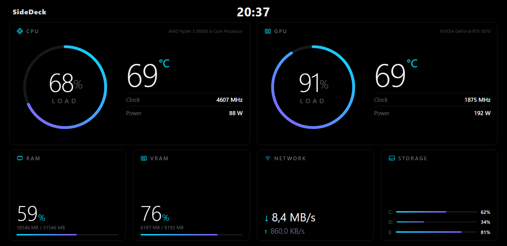
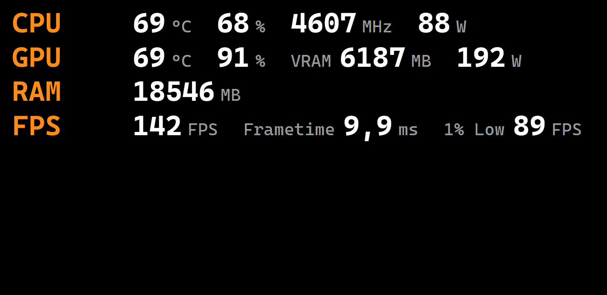
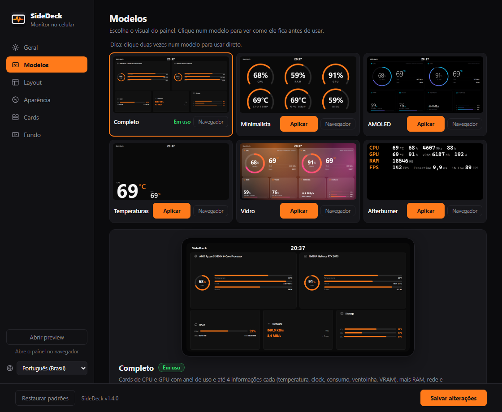
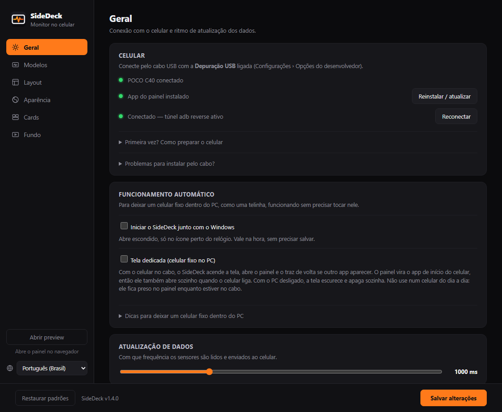
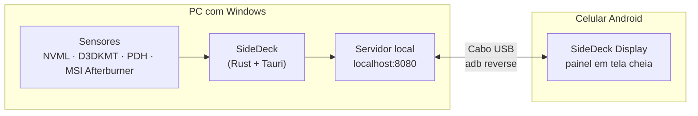

<p align="center">
  
</p>

<h1 align="center">SideDeck</h1>

<p align="center">
  <b>Transforme um celular Android parado num monitor de hardware ao vivo para o seu PC.</b><br />
  CPU, GPU, RAM, rede, armazenamento e FPS numa telinha ao lado — ou dentro — do gabinete.<br />
  Pelo cabo USB. Sem Wi-Fi, sem conta, sem nuvem.
</p>

<p align="center">
  <a href="https://github.com/waltinho17/sidedeck/releases/latest"></a>
</p>

<p align="center">
  <a href="https://github.com/waltinho17/sidedeck/releases/latest"></a>
  
  
  <a href="LICENSE"></a>
</p>

<p align="center">
  <a href="README.en.md">English</a> · <b>Português</b>
</p>

<p align="center">
  
</p>

## Por quê

Telas que mostram as temperaturas do PC — o LCD de alguns water coolers, as telinhas USB feitas para gabinete — custam caro e só fazem isso. Quase todo mundo tem um celular antigo na gaveta com uma tela melhor. O SideDeck dá um uso para ele: conecte no cabo, escolha um visual e ele vira um painel de sensores que liga e desliga junto com o PC.

## O que ele faz

- **Seis modelos de painel** — Completo, Minimalista, AMOLED (preto puro), Temperaturas, Vidro (estilo iOS) e Afterburner (linhas de texto como o OSD do MSI, espelhando o seu Afterburner). Veja cada um antes de usar, no PC ou direto na tela do celular, e troque com um clique.
- **Do seu jeito** — mais de 30 paletas prontas, as suas próprias cores ou as cores do seu RGB (importadas do [OpenRGB](https://openrgb.org)), 7 fontes, tamanhos, espaçamento, unidades, relógio ligado ou desligado, e quais sensores aparecem — organizados arrastando numa cópia da tela do celular. Cada modelo guarda o próprio visual.
- **Celular pronto em um clique** — conecte o celular e o SideDeck instala o app do painel pelo cabo. O passo a passo está dentro do programa.
- **Liga e esquece** — inicia com o Windows, reconecta sozinho e, no modo *Tela dedicada*, o celular acende junto com o PC e apaga quando ele desliga. Feito para um celular fixo dentro do gabinete.
- **Fundos em vídeo ou imagem** — use um vídeo ou uma foto como fundo do painel ou como descanso de tela, com as temperaturas por cima, e escolha como ela se encaixa na tela (preencher, mostrar inteira ou esticar). O modelo Vidro deixa o fundo fosco atrás dos cartões.
- **Avisa quando sai versão nova** — a versão aparece no rodapé da janela e, havendo uma mais nova, um botão leva direto para o download.
- **Leve e privado** — programa nativo que fica perto do relógio, não pede administrador e não manda nada seu para lugar nenhum (a única consulta à internet é perguntar ao GitHub se existe uma versão nova).
- **Em português e inglês.**

## Modelos de painel

| Completo | Minimalista |
| :---: | :---: |
|  |  |
| Cards de CPU e GPU com anel de uso e até 4 informações cada, mais RAM, rede e armazenamento. Desligue um card e os outros se reorganizam para ocupar o espaço. | Anéis grandes com os sensores que você escolher, redimensionados para ocupar a tela. Dá para ler de longe. |
| **AMOLED** | **Temperaturas** |
|  |  |
| Preto puro com traços finos, feito para telas AMOLED (menos bateria e calor). | Só as temperaturas da CPU e da GPU: números enormes ou anéis com degradê. Posição, legenda e tamanho ajustáveis. |
| **Vidro** | **Afterburner** |
|  |  |
| Cartões de vidro fosco, estilo iOS, sobre cores em movimento ou sobre o seu fundo. Leve o bastante para celulares simples. | Linhas de texto no estilo do OSD do MSI Afterburner (CPU, GPU, RAM, FPS, frametime, 1% low). Espelha o que você marcou no Afterburner ou escolha as linhas no SideDeck, com nomes personalizados. |

<p align="center">
  
</p>

## Requisitos

**PC**

- Windows 10 ou 11, 64 bits.
- Uma porta USB livre (de preferência da placa-mãe, atrás do gabinete).
- Microsoft Edge WebView2 — já vem no Windows 11; no Windows 10 o instalador baixa se faltar.
- Porta 8080 livre — é nela que o SideDeck serve o painel, só para o próprio PC.

**Celular**

- Android 7.0 ou mais novo.
- Cabo USB **de dados** (alguns cabos só carregam).
- **Depuração USB** ligada — o programa ensina como. Em Xiaomi, Redmi e POCO, ligue também *Instalar via USB* e *Depuração USB (Configurações de segurança)*.

**Sensores** — o que funciona direto e o que precisa de um programa extra (gratuito):

| Leitura | Direto | Precisa de |
| --- | :---: | --- |
| Uso e clock da CPU, RAM, rede, armazenamento | ✅ | — |
| Uso, temperatura, clock e memória da GPU | ✅ | — |
| Ventoinha e consumo da GPU | ✅ NVIDIA | AMD / Intel: [MSI Afterburner](https://www.msi.com/Landing/afterburner/graphics-cards) |
| Temperatura e consumo da CPU | — | [MSI Afterburner](https://www.msi.com/Landing/afterburner/graphics-cards) |
| FPS nos jogos | — | MSI Afterburner + RivaTuner Statistics Server (vem junto) |

> O Windows não informa a temperatura da CPU sem um driver de kernel, então o SideDeck lê esse valor do MSI Afterburner quando ele está aberto. Testado com NVIDIA; placas AMD e Intel usam os mesmos contadores do Gerenciador de Tarefas — relatos são bem-vindos.

## Primeiros passos

1. **Instale o SideDeck** — baixe o `SideDeck_x.y.z_x64-setup.exe` em [Releases](https://github.com/waltinho17/sidedeck/releases/latest) e execute. O Windows pode avisar sobre editor desconhecido: clique em *Mais informações › Executar assim mesmo*.
2. **Prepare o celular** — ligue as *Opções do desenvolvedor* e a *Depuração USB*. O SideDeck mostra o passo a passo em *Primeira vez? Como preparar o celular*.
3. **Conecte o cabo** — toque em *Permitir* no celular (marque *Sempre permitir deste computador*) e clique em **Instalar app** no SideDeck.
4. **Escolha um modelo** na aba *Modelos*, ajuste em *Layout* e *Aparência* e clique em **Salvar alterações**. O celular atualiza na hora.

<p align="center">
  
</p>

## Um celular dentro do gabinete

Ligue **Iniciar o SideDeck junto com o Windows** e **Tela dedicada** na aba *Geral*. A partir daí:

- o painel vira o app de início do celular e volta sozinho se outro app abrir;
- quando o PC liga, o SideDeck reconecta, acende o celular e mostra o painel;
- quando o PC desliga, o celular escurece e a tela apaga.

A seção *Dicas para deixar um celular fixo dentro do PC*, no programa, mostra as opções do celular que deixam tudo confiável (autorização que não expira, tela de bloqueio sem PIN, limite de carga da bateria, energia do USB).

## Problemas comuns

| Problema | O que fazer |
| --- | --- |
| Celular não aparece | Use um cabo de dados e outra porta USB, confira a *Depuração USB* e toque em *Permitir* no celular. |
| "Falha ao instalar" em Xiaomi / Redmi / POCO | Ligue *Instalar via USB* nas Opções do desenvolvedor, ou use *Problemas para instalar pelo cabo?* para copiar o APK. |
| Celular mostra "Aguardando o PC" | Confira se o SideDeck está aberto (ícone perto do relógio) e clique em **Reconectar**. |
| Temperatura da CPU aparece `--` | Instale e deixe aberto o MSI Afterburner. |
| Vídeo ou imagem não entra na galeria | Vídeos: até 80 MB e 1920×1080, em .webm (VP9) ou .mp4 (H.264); imagens: até 15 MB (.jpg, .png, .webp, .gif). Vídeos maiores pesam demais para a maioria dos celulares. |
| Outra coisa | O registro da conexão fica em `%APPDATA%\SideDeck\sidedeck.log`. Anexe esse arquivo ao abrir uma issue. |

## Como funciona



O SideDeck lê os sensores, serve o painel em `localhost:8080` e usa o `adb reverse` para o celular chegar nesse endereço pelo cabo USB. O app do celular é uma tela cheia, sempre acesa, mostrando esse painel. Nada sai dos dois aparelhos.

## Compilando o código

Você precisa do [Rust](https://rustup.rs) (toolchain MSVC) e do [Node.js](https://nodejs.org) 18+.

```powershell
cd pc-monitor-host
npm install
npm run tauri dev      # roda em modo de desenvolvimento
npm run tauri build    # instalador em src-tauri/target/release/bundle/nsis/
```

O app do celular precisa do JDK 17 e do Android SDK:

```powershell
cd android-kiosk
.\gradlew.bat assembleDebug   # com o JAVA_HOME apontando para um JDK 17
copy app\build\outputs\apk\debug\app-debug.apk ..\pc-monitor-host\src-tauri\android\SideDeck-Display.apk
```

```
pc-monitor-host/          Programa do Windows (Tauri 2 + Rust)
  src/                    Painel (index.html, main.js) e janela de configurações (settings.*, i18n.js)
  src-tauri/src/          Sensores, servidor local, supervisor da conexão adb
  src-tauri/adb/          adb embutido (Android SDK Platform-Tools)
  src-tauri/android/      App do celular embutido (APK)
android-kiosk/            App do celular "SideDeck Display" (Kotlin, WebView em tela cheia)
branding/                 Arquivos do ícone; videos/make_videos.py gera os fundos padrão
```

## Créditos

Feito com [Tauri](https://tauri.app). Usa o `adb` do Android SDK Platform-Tools, a [NVML](https://developer.nvidia.com/nvidia-management-library-nvml) via [nvml-wrapper](https://github.com/Cldfire/nvml-wrapper) e fontes do [Google Fonts](https://fonts.google.com) ([SIL Open Font License](pc-monitor-host/src/assets/fonts/OFL.txt)). FPS, temperatura e consumo da CPU vêm do [MSI Afterburner](https://www.msi.com/Landing/afterburner/graphics-cards) quando ele está instalado. Os vídeos de fundo padrão (Aurora, Ondas, Bokeh, Synthwave) são gerados por código em `branding/videos` e seguem a mesma licença.

## Sugestões e problemas

Achou um bug ou testou o SideDeck num hardware que não aparece acima (placa de vídeo AMD ou Intel, outros celulares)? [Abra uma issue](https://github.com/waltinho17/sidedeck/issues) — em problemas de conexão, anexe o `%APPDATA%\SideDeck\sidedeck.log`.

## Licença

[MIT](LICENSE)
